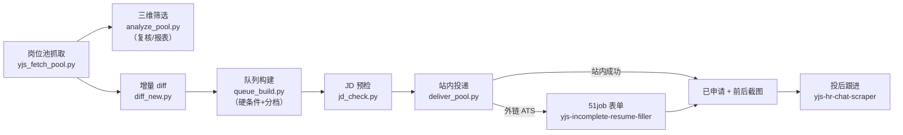

# yjs-job-skills

> 把「在应届生求职网上找工作」变成一条可重复执行的流水线：**抓外企岗位池 → 三维筛选 → 增量 diff → JD 预检 → 站内一键投递 → 投后跟进**。

这是一套跑在本机的 Agent 技能包（WorkBuddy / Claude Code 通用），不是 SaaS。所有岗位数据、简历、登录态、投递记录都留在你自己的电脑上，脚本通过 Chrome DevTools Protocol（CDP 9222）复用你已登录的浏览器，不保存账号密码。

- **不做**：不破解验证码、不伪造身份信息、不绕过平台风控。
- **只做**：把重复的「翻页、比对、填表、点投递」交给脚本，判断和确认留给人。

---

## 一、包含哪些技能

| 技能 | 解决什么问题 | 什么时候用 | 主要产出 |
|---|---|---|---|
| [**yjs-job-pipeline**](skills/yjs-job-pipeline/) | 四段管道：抓取 → 分析 → 增量 diff → 投递 | 每天跑一批新岗位；首次建池 | 岗位池 JSON、`new_jobs.json`、投递前后截图、`deliver_state.json` |
| [**yjs-incomplete-resume-filler**](skills/yjs-incomplete-resume-filler/) | 把「待完善投递」里 51job 分步简历逐条填完并提交 | 岗位跳到 51job 网申（JobsSelect / FillInResume / consumer 三种页面） | 投递成功页截图、`delivery_log.csv` |
| [**yjs-hr-chat-scraper**](skills/yjs-hr-chat-scraper/) | 导出 HR 聊天记录、查「谁对我感兴趣」、扫待回复会话 | 投递之后的跟进环节 | `chat_*.json/.csv`、`needs_reply_*.json` |
| [**job-delivery**](skills/job-delivery/) | 按 Excel 队列逐岗投递的通用 Agent（含 CDP 三层降级、Chrome 调试启动手册、站点实战脚本） | 外链 ATS 表单、按队列顺序批量投、需要留痕复盘 | `delivery_log.csv`、`issue_log.md`、投递截图 |
| [**pipeline/**](pipeline/) | 上面管道前三段的实体脚本（抓取 / 筛选 / 队列 / 预检） | 与 `yjs-job-pipeline` 配套使用 | `pool_*/` 目录 |

> **CDP 操作在哪？** 四个技能全都靠 CDP 直连本机 Chrome 的 9222 端口，实现在四处：`yjs-incomplete-resume-filler/scripts/cdp.py`（通用驱动，被 16 个脚本 import）、`yjs-job-pipeline/scripts/deliver_pool.py`（自带 `Tab` 类，单文件自足）、`yjs-hr-chat-scraper/scripts/fetch_chat.py`（注入 IM SDK）、`job-delivery/scripts/raw_cdp_chrome.py`（重型客户端，tier-2 降级）。三种实现的取舍、最小代码片段、端口不通的定位流程，见 **[docs/cdp.md](docs/cdp.md)**。

> `yjs-job-pipeline` 的 SKILL.md 原本把抓取/分析/diff 三步委托给一个名为 `yjs-foreign-job-scraper` 的技能，但该技能目录在当前机器上已不存在。本仓库把实际在跑的等价脚本收在 `pipeline/`，并把 SKILL.md 里的路径改为指向 `pipeline/`，保证整条链路可以直接跑通（详见「已知限制」）。

---

## 二、端到端流程



四段管道的职责边界：

1. **抓取**：按企业规模分段（500-1000 / 1000-5000 / 5000-10000 / 10000+ 人）拉外企池（`cotype=01,02,06`），分段幂等，支持 `--only` 补抓。
2. **筛选**：薪资、企业规模、岗位方向三维打分；剔除销售/房产/管家/博士岗；输出达标清单，供人工复核与报表。
3. **diff**：直接吃全量池，与上一份快照对比找出新上架岗位，并剔除 `deliver_state.json` 里已投过的。
4. **队列**：在 diff 结果上再过一遍硬条件与分档（`std` / `relaxed`），同公司限投 2 个，产出最终队列。
5. **投递**：逐岗开新标签、等 SPA 渲染、真实坐标点击、校验「投递成功」弹窗或按钮变「已申请」、前后各截一张图。

---

## 三、目录结构

```
yjs-job-skills/
├── README.md                     # 本文件
├── LICENSE                       # MIT
├── .gitignore                    # 凭证、截图、运行产物一律不入库
├── skills/
│   ├── yjs-job-pipeline/
│   │   ├── SKILL.md              # 技能定义（触发词、流程、红线）
│   │   ├── README.md             # 中文说明：用途 / 功能 / 场景 / 文件
│   │   └── scripts/
│   │       └── deliver_pool.py   # 投递引擎（也可 import Tab 复用）
│   ├── yjs-incomplete-resume-filler/
│   │   ├── SKILL.md
│   │   ├── README.md
│   │   ├── references/
│   │   │   └── page-patterns.md  # 三类 51job 简历页的踩坑打法
│   │   └── scripts/              # cdp / 列表 / 分步 / 滑块 / 上传 等 14 个脚本
│   ├── yjs-hr-chat-scraper/
│   │   ├── SKILL.md
│   │   ├── README.md
│   │   ├── config.example.json
│   │   ├── assets/
│   │   │   └── tx_umd.min.js     # 腾讯云 IM Web SDK（离线加载）
│   │   ├── references/           # 抓包指南 / 协议 / Web 端路径
│   │   └── scripts/              # extract_creds.py / fetch_chat.py
│   └── job-delivery/
│       ├── SKILL.md              # 核心原则 8 条 + 6 步工作流 + 实战补丁 10 条
│       ├── README.md
│       ├── references/           # 投递细节 / 队列读取 / 邮件确认 / 工具边界
│       └── scripts/              # check_cdp / start_chrome_debug / raw_cdp_chrome
│                                 # batch_scan / detect_apply / 站点实战脚本
├── pipeline/
│   ├── README.md
│   ├── yjs_fetch_pool.py         # 签名接口分段抓取
│   ├── analyze_pool.py           # 薪资/规模/方向筛选
│   ├── diff_new.py               # 快照 diff
│   ├── queue_build.py            # 投递队列构建（含 std / relaxed 两档）
│   ├── queue_build_agent.py      # 队列构建的 agent 版
│   └── jd_check.py               # 投递前 JD 正文预检
└── docs/
    ├── workflow.md               # 每一步的输入输出契约
    ├── cdp.md                    # CDP 层总览：四处实现、最小片段、端口排障
    └── security.md               # 凭证、脱敏、账号风险
```

**命名约定**：技能目录统一 `yjs-` 前缀 + 小写连字符；每个技能根目录必须有 `SKILL.md`（Agent 读取的事实源）与 `README.md`（人类阅读的中文说明）；脚本放 `scripts/`，参考资料放 `references/`。

---

## 四、安装

### 1. 装技能

```bash
git clone <本仓库地址> && cd yjs-job-skills
```

Windows PowerShell：

```powershell
Copy-Item -Recurse skills\* "$env:USERPROFILE\.workbuddy\skills\"
```

macOS / Linux：

```bash
cp -r skills/* ~/.workbuddy/skills/
```

只想要其中一个，就单独拷贝对应目录。`pipeline/` 不必装进技能目录，放在仓库里直接运行即可。

> `job-delivery` 里的路径、简历文件名、登录态正则都是**本机口径**，拷走前必须改（清单见 [skills/job-delivery/README.md](skills/job-delivery/README.md#六使用前必须改的地方)）。

### 2. 前置条件

| 项 | 要求 |
|---|---|
| Chrome | 以 `--remote-debugging-port=9222` 启动，且已登录应届生求职网。端口不通先用 `skills/job-delivery/scripts/check_cdp.py` 看退出码，再按 [docs/cdp.md](docs/cdp.md) 处置（Chrome ≥136 需 junction） |
| Python | 3.10+；投递脚本人肉依赖仅 `websocket-client` |
| 聊天抓取 | `websocket-client`；提取凭证另需 `mitmproxy`（建议独立 venv，11.x） |
| 网络 | 脚本启动会剥离代理环境变量并置 `NO_PROXY=*`，避免本机代理干扰 CDP 直连 |

### 3. 签名密钥

`pipeline/yjs_fetch_pool.py` 通过 HMAC-SHA256 签名调用站点的公开搜索接口。签名密钥**不随仓库分发**，运行前需自行从前端资源中取得并注入环境变量：

```powershell
$env:YJS_SIGN_KEY = "<你的签名密钥>"
```

```bash
export YJS_SIGN_KEY="<你的签名密钥>"
```

未设置时脚本会直接退出并提示，不会带着空密钥请求接口。

---

## 五、快速开始

```bash
# 1. 抓今天的池（分段、幂等）
python pipeline/yjs_fetch_pool.py --out pool_2026-11-27

# 2. 三维筛选
python pipeline/analyze_pool.py --dir pool_2026-11-27

# 3. 与上一份快照 diff（找新岗位）
python pipeline/diff_new.py --dir pool_2026-11-27 \
    --snapshot pool_2026-11-26/pool_foreign_segmented.json

# 4. 构建投递队列（剔除已投、按公司限投）
python pipeline/queue_build.py --dir pool_2026-11-27 --state deliver_state.json

# 5. 投递前 JD 预检（剔除 3 年以上经验 / 博士 / 已下线）
python pipeline/jd_check.py --queue pool_2026-11-27/deliver_queue.json \
    --out pool_2026-11-27/jd_details.json

# 6. 投递（每岗约 1 分钟；中断后重跑同一命令即可续跑）
python skills/yjs-job-pipeline/scripts/deliver_pool.py \
    --queue pool_2026-11-27/deliver_queue.json --state deliver_state.json \
    --cooldown 30 --passes 2 --shots logs/deliver_2026-11-27
```

投递状态只有 `Submitted` / `Skipped` 会写入 `deliver_state.json`，其余状态（`NeedsUser`、`Unknown`、`Redirect`、`Error`）都不算成功，重跑时会被再次尝试。

---

## 六、关键设计

- **文件即契约**：每一步只通过落盘文件传话（`pool_*.json` → `new_jobs.json` → `deliver_queue.json` → `delivery_results.json`），失败可单独重试，不靠上下文记忆。
- **幂等优先**：抓取按段跳过已有文件；投递按 `deliver_state.json` 去重；结果实时落盘，断网/关窗后重跑只补未完成项。
- **成功要有证据**：以页面弹窗「投递成功」或按钮变「已申请」为唯一成功信号，并保存前后截图；不因收件箱没有回执而重投。
- **人工兜底**：遇到滑块、登录失效、外链 ATS 一律停下并标记状态，交给人工处理，不硬闯。
- **只用 CDP，不接管账号**：全部浏览器操作都走本机 Chrome 的 9222 调试端口，复用你已登录的会话，不存账号密码、不装浏览器插件。四种实现与排障见 [docs/cdp.md](docs/cdp.md)。

---

## 七、隐私与安全

- 仓库内**不含**任何真实凭证、简历文件、手机号、邮箱、聊天记录与投递截图；`.gitignore` 已覆盖 `im_creds.json`、`chat_out/`、`out/`、`pool_*/`、`*.png`。
- **但本仓库仍须保持 Private**：`skills/job-delivery/` 与 `skills/yjs-incomplete-resume-filler/SKILL.md` 含真实姓名、学历/语言等个人信息与 `C:\Users\<user>\...` 本机路径（姓名被用作登录态判定正则，删了会导致检测失效）。公开前必须先把这些替换成占位符。
- `im_creds.json` 等同账号密码（48 小时有效），只应存在于本机，切勿提交或外传。
- 导出的聊天记录包含 HR 联系方式，注意保存与二次分享范围。
- 详细清单与处置方式见 [docs/security.md](docs/security.md)。

---

## 八、已知限制

| 限制 | 说明 |
|---|---|
| **不是全自动** | 滑块、短信、外链 ATS 都需要人工；管道只覆盖 yjs 站内一键投递 |
| **口径有漂移** | `yjs-job-pipeline/SKILL.md` 写「年薪 ≥24 万」，而实际脚本 `analyze_pool.py` 已放宽到 **≥20 万**（2026-11-04）。以脚本为准，SKILL.md 待同步 |
| **缺失的抓取技能** | `yjs-foreign-job-scraper` 已不在本机技能目录，`pipeline/` 是等价脚本的归拢，不是原技能的完整复刻；`yjs-job-pipeline/SKILL.md` 里的路径已改为指向 `pipeline/` |
| **job-delivery 是本机口径** | 内含 `Desktop\工作agent` 绝对路径、简历文件名与姓名正则，搬家需逐项替换；其 `RawCDPChrome` 另需 `aiohttp` + `websockets`（`check_cdp.py` 仍为纯标准库） |
| **平台改版即失效** | 全部依赖页面结构（`.delivery-btn`、Element UI 组件等），平台一改就要修选择器 |
| **WAF 与软风控** | 连续快速开页会触发滑块；密集自动化后接口可能返回空 200。处置是冷却 30–60 分钟，不是加大重试 |
| **账号风险** | 自动化操作可能触发平台风控，后果自负；建议控制频率、保留人工确认 |

---

## 九、常见问题

**Q：9222 连不上？**
先 `curl http://127.0.0.1:9222/json/list`。不通就跑 `python skills/job-delivery/scripts/check_cdp.py` 看退出码（0 正常 / 1 端口不通 / 2 Chrome 没开 / 3 端口被占），再按 [docs/cdp.md](docs/cdp.md) 处置。脚本不会 kill 你的浏览器。

**Q：这套技能的 CDP 代码在哪个文件？**
四处：`yjs-incomplete-resume-filler/scripts/cdp.py`（通用驱动，16 个脚本 import 它）、`yjs-job-pipeline/scripts/deliver_pool.py`（自带 `Tab`）、`yjs-hr-chat-scraper/scripts/fetch_chat.py`（注入 IM SDK）、`job-delivery/scripts/raw_cdp_chrome.py`（重型客户端）。对照表与最小片段见 [docs/cdp.md](docs/cdp.md)。

**Q：投递一直 `NeedsUser`？**
大概率是滑块。脚本会等 `--waf-wait` 秒后重试一次，仍不过就跳过该岗位；人工在 Chrome 里滑一次，会话 Cookie 恢复后重跑即可。

**Q：抓取返回 405？**
单段连续 405 是限流，不是接口失效。冷却 90–180 秒后用 `--only <段号>` 补抓。

**Q：投完没有收到邮件，是不是没投上？**
yjs 站内一键投递没有邮件回执，以「已申请」按钮状态 + 截图为准。

---

## 十、变更记录

- **2026-11-27（首次发布）**：三个 yjs 技能脱敏（移除 `im_creds.json`、运行截图、个人绝对路径、签名密钥），补齐 `pipeline/` 脚本，新增各技能中文 README。
- **2026-11-27（补充 CDP 层）**：新增第 4 个技能 `job-delivery`（队列投递 + CDP 三层降级 + Chrome 调试启动手册）；新增 [docs/cdp.md](docs/cdp.md) 汇总四处 CDP 实现；修正 `yjs-job-pipeline/SKILL.md` 中指向已不存在的 `yjs-foreign-job-scraper` 的三处路径，补上队列构建与 JD 预检两步命令。

## 免责声明

本项目仅用于个人求职效率工具与技术研究。使用者应遵守目标网站的用户协议与相关法律法规，控制请求频率，不得用于批量骚扰、数据倒卖或商业牟利。因使用本项目导致的账号限制、封禁或法律后果，由使用者自行承担。

## License

[MIT](LICENSE)
