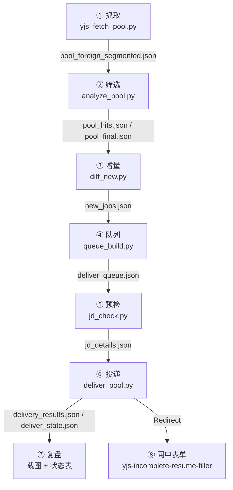

# 数据流与契约

每一步只通过落盘文件传话，不依赖上下文记忆。失败可以单独重试，不会牵连上下游。

## 文件契约

| 生产者 → 消费者 | 文件 | 关键字段 | 失败处理 |
|---|---|---|---|
| 抓取 → 筛选 | `pool_foreign_segmented.json` | `id, jobname, coname, cosize, salary, jobarea, degree, jobTags[], url` | 单段 405 只影响该段，冷却后 `--only` 补抓 |
| 筛选 → diff | `pool_hits.json` / `pool_final.json` | 同上 + `score` | 解析失败跳过该条并打印原因 |
| diff → 队列 | `new_jobs.json` | `id, co, job, url` | 快照缺失时退化为全量 |
| 队列 → 预检 | `deliver_queue.json` | 同上 + `salary, match` | 空队列直接退出 0 |
| 预检 → 投递 | `jd_details.json` | `id, btn, years, degree, offline` | 页面读不到记 `unknown`，交人工 |
| 投递 → 去重 | `deliver_state.json` | `done: {jobid: {...}}` | 首次运行自动初始化 |
| 投递 → 复盘 | `delivery_results.json` | `id, status, confirm, pre, post` | 实时落盘，中断可续跑 |

## 状态机

| 状态 | 触发条件 | 是否算投递成功 | 是否写 state |
|---|---|---|---|
| `Submitted` | 弹窗含「投递成功」或按钮变「已申请」 | ✅ | ✅ |
| `Skipped` | 按钮已是「已申请 / 已投递」 | ✅（历史已投） | ✅ |
| `NeedsUser` | 出现滑块 / Access Verification | ❌ | ❌ |
| `Unknown` | 点击后无成功信号 | ❌ | ❌ |
| `Redirect` | 详情页跳转外部域名 | ❌ | ❌ |
| `Error` | 页面不可读 / 脚本异常 | ❌ | ❌ |
| `NeedsInvestigation` | 找不到投递按钮等 | ❌ | ❌ |

## 幂等约定

1. **抓取**：`pool_size_<seg>.json` 已存在且非空则跳过该段。
2. **投递**：只补跑状态不在 `{Submitted, Skipped}` 的岗位；同一队列重跑不会重复投。
3. **队列**：`queue_build.py` 每次重建，剔除 `deliver_state.json` 中已投 jobid。
4. **截图**：按 `{序号}_{id}_pre.png` / `_post.png` 命名，重跑覆盖同名文件，不产生副本。

## 升级注意

- 新增一个环节：先定义输出文件与 `schema_version`，再改下游的读取与降级逻辑，最后补本表。
- 改筛选口径：只改 `analyze_pool.py` / `queue_build.py` 的常量，不要改 `SKILL.md` 之外的文档作为事实源——以脚本为准。
